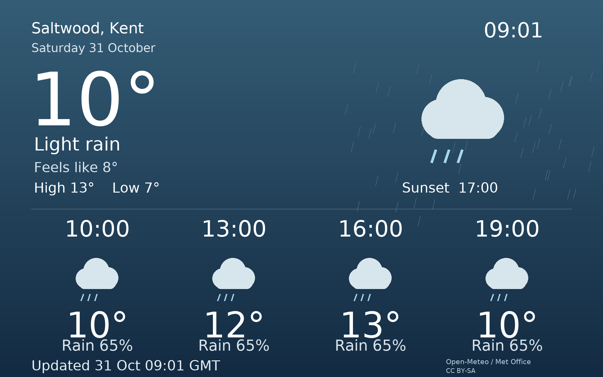
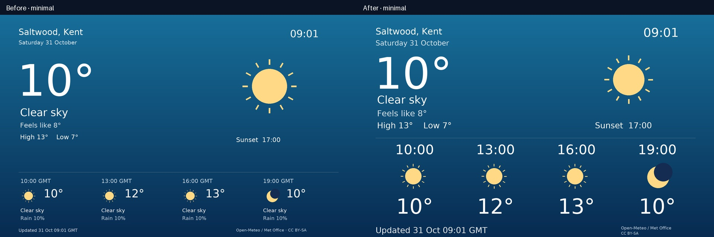
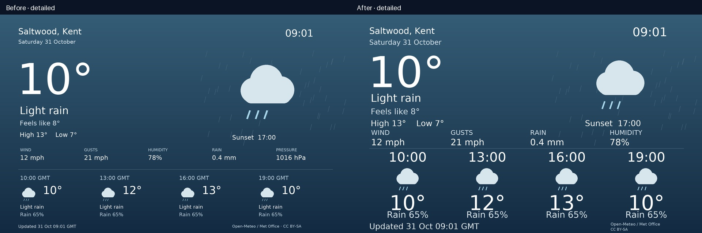

# picframe-weather-cards

A standalone, headless Python service producing 1920 × 1200 weather cards for digital photo frames. Pillow is the only runtime dependency. No desktop, browser, database, Docker or picframe imports. Defaults to Saltwood near Hythe, Kent; coordinates are configurable.



[Before / after comparisons](gallery/README.md) · [All-theme contact sheet](gallery/contact-sheet.jpg) · [14-inch / 10-foot assessment](gallery/viewing-distance.md)

## Readable from the sofa

The layouts now prioritise four future times, icons and temperatures on the 14-inch display. The main temperature stays at 235 px, while the forecast moves upwards into previously unused space. The palette, ten themes and automatic layout rules are unchanged.

| Forecast element | Previous | Revised |
| --- | --- | --- |
| Time | 30 px | 72 px |
| Temperature | 60 px | 112 px |
| Icon box | 95 px | 180 px minimal / 160 px detailed |
| Useful precipitation probability | 27 px | 48 px |
| Offline / update message | 23 px | Up to 44 px, fitted for long messages |

Repeated weather descriptions beneath the icons are removed. Precipitation probability (labelled Precip for frozen precipitation) appears at 20% or above, or for wet, snow or storm codes even at a lower probability. Detailed cards retain wind, gusts, rainfall and humidity with larger values; pressure remains in fetched/cached data but is omitted from the display. Times normally omit GMT/BST; ambiguous autumn hours include the timezone suffix even if only one of the repeated hours is selected.

On a 14-inch 16:10 panel, DejaVu forecast time digits grow from approximately **3.5 mm to 8.5 mm** tall and forecast temperature glyphs from **7.1 mm to 13.2 mm**. The physical-size calculation supports a material improvement; comfortable reading at ten feet still needs a manual check on your frame. Secondary metrics and source attribution remain smaller than the main forecast. See the [viewing assessment](gallery/viewing-distance.md) for angular sizes and an equivalent-angle review method.





All comparison data is simulated; the minimal example recreates Saltwood at 09:01 on Saturday 31 October with 10°C and clear sky. The old and new sides use identical data and font. The original renderer is frozen in `tools/baseline_render.py` solely to reproduce these comparisons. Production rendering uses `src/weather_cards/render.py`.

This update changes presentation only: fetching, validation, cache/freshness policy, queue snapshots, scheduling, configuration and service definitions retain their existing behaviour.

## Install on Raspberry Pi OS Lite (Debian 13)

This repository does not install itself or change any frame services. Clone the standalone repository below.

```sh
sudo apt update
sudo apt install -y git python3-venv fonts-dejavu-core
git clone https://github.com/nickymoomeh/picframe-weather-cards.git ~/picframe-weather-cards
cd ~/picframe-weather-cards
python3 -m venv .venv
.venv/bin/python -m pip install .
mkdir -p ~/.config/weather-card ~/.local/state/weather-card /home/pi4/FrameCards
cp config.example.toml ~/.config/weather-card/config.toml
# Review coordinates, paths, layout and queue settings:
nano ~/.config/weather-card/config.toml
.venv/bin/weather-card validate-config
.venv/bin/weather-card preview --theme rain --layout detailed --output /home/pi4/FrameCards/preview.png
.venv/bin/weather-card generate
.venv/bin/weather-card status
.venv/bin/weather-card queue
```

Run as `pi4`, or adjust **all** paths in configuration and the service. The frame service user needs read access to the images and parent directory. Keep FrameCards outside the photo library. No root privileges are needed for normal operation. The default coordinates (51.080, 1.085) are approximate; refine them for your home if desired.

The frame must already have `slideshow.card_directory: /home/pi4/FrameCards` configured. This application does not alter the frame configuration. Its integration was checked against [PR #1](https://github.com/nickymoomeh/Digital-Picture-Frame-Pi-2026/pull/1), head `04d9aa13068263073fc1bb4a7e2a6d2d599f6e36`, including `docs/CARDS.md`. It posts `action=queue_card`, `path=<immutable PNG>`, `duration=30`, `type=weather` to `http://localhost:9000/api/command`. That endpoint accepts durations 1–3600 seconds and absolute paths inside the configured directory. HTTP acceptance is asynchronous; it does not prove the card has appeared.

For authenticated frame APIs, set `WEATHER_CARD_AUTHORIZATION` to the full HTTP Authorization header value (for example `Basic …`) in your shell, or put it in `~/.config/weather-card/environment` for systemd. Keep that file private (`chmod 600`). Never commit credentials. There is no authentication or state query requirement when merely generating images.

## Enable unattended operation

```sh
mkdir -p ~/.config/systemd/user
cp systemd/weather-card.* ~/.config/systemd/user/
systemctl --user daemon-reload
systemctl --user enable --now weather-card.timer
sudo loginctl enable-linger pi4
systemctl --user start weather-card.service
systemctl --user status weather-card.timer
journalctl --user -u weather-card.service -n 50
```

The user timer runs once a minute, starting 45 seconds after boot; lingering starts the user manager without login. The oneshot service never overlaps itself; an advisory file lock also excludes simultaneous CLI writes. Every tick checks persisted schedules, fetching every 30 minutes independently of queue attempts every 60 minutes. Missed intervals are coalesced into one operation, never replayed as a backlog. A reboot preserves schedules. Wall-clock reversal makes refresh due and permits one queue attempt, then resets scheduling. Rendering uses under 10 MB for its base RGB canvas; no resident daemon is needed. Actual Pi memory and timing have not been benchmarked.

The default queue window is 07:00 inclusive to 20:30 exclusive, Europe/London; forecast refresh continues overnight. A window crossing midnight is supported; identical endpoints mean all day. Queue cadence is based on the last attempt, so the first card after opening may wait up to one interval. Display power does not affect fetching. systemd isolation requires the configured state and output directories to exist before startup; update `ReadWritePaths` if changing them.

## Configuration and commands

See the commented [sample TOML](config.example.toml). All keys are optional and default to its values; unknown keys and invalid types are rejected. `--config PATH` goes **before** the subcommand.

```sh
.venv/bin/weather-card --config ~/.config/weather-card/config.toml generate
.venv/bin/weather-card generate --offline
.venv/bin/weather-card preview --theme clear-night --output night.png
.venv/bin/weather-card preview --theme snow --layout detailed --output snow.png
.venv/bin/weather-card queue
.venv/bin/weather-card status
.venv/bin/weather-card validate-config
.venv/bin/weather-card tick
```

`generate` explicitly refreshes and publishes but does not queue. `--offline` reads cache without any network call. `queue` requests the existing image, respecting the time window and interval even when invoked manually. It exits 1 when skipped or unsuccessful; operational/configuration errors exit 2. `tick` is the scheduler entry point. Preview needs neither a configuration file nor network, never updates production cache, and writes to its explicitly requested output (default `preview.png`). Use preview output paths outside production names.

Layout `automatic` chooses detailed when precipitation is greater than zero, gusts are at least 25 mph, or WMO weather code is 45 or greater; otherwise minimal. Explicit minimal/detailed overrides this rule. Detailed displays humidity, rainfall, wind and gusts; sea-level pressure is still fetched and validated but omitted from the card to give the forecast more space. Main temperature and feels-like use Celsius, precipitation mm, wind mph, pressure hPa. Current conditions are model estimates, not a local weather station observation. Four forecast points are the first future hour followed by points at least three hours apart. Hourly precipitation probability refers to the respective hour, not the full three-hour gap.

Themes: sunny, partly-cloudy, overcast, rain, heavy-rain, thunderstorm, snow, fog, clear-night, cloudy-night. At night clear codes 0/1 select clear-night; all other conditions select cloudy-night, while the textual description preserves the actual condition. For cached current data the backdrop uses today's solar timestamps and actual current time. Forecast icons use each future hour's day/night flag. Dates are English; times use 24 hours and ZoneInfo handles BST/GMT. Forecast rows show timezone abbreviations only for ambiguous autumn hours; ordinary times use just HH:MM. No global OS timezone or locale changes are required.

## Offline design

Network requests have a 10-second timeout and a 2 MB response limit. Each refresh makes at most two attempts separated by one second: configured model first, then `best_match`. This includes errors, unsupported variables/models, timeouts and validation failures. After both fail, no more attempts occur until the next refresh interval. Queue requests are independent and never prevent saving an image.

Validation rejects missing required current/hourly/daily fields, null/nonfinite/out-of-range values, unknown weather codes, invalid day flags, empty/unequal arrays, unordered timestamps, inconsistent daily extremes/solar times and current times outside forecast coverage. Live acceptance additionally requires current data within 90 minutes of retrieval and at least 12 hours of forecast horizon. Invalid responses never overwrite the last valid cache.

The cache records schema, location coordinates, retrieval epoch, forecast end and validated raw data. Reuse revalidates it, verifies its location and validity metadata, and rejects corrupt/future retrieval dates. State/cache JSON and PNGs are written to temporary files in the same directory, flushed, synced and published with `os.replace`. Failed writes leave the previous complete file intact. Cache retrieval time advances only on a validated successful fetch.

| Age | Presentation |
| --- | --- |
| Up to 60 minutes | Normal with original update time; failed fetch still gets red dot and Offline label |
| 60–180 minutes | Earlier forecast label with original update time |
| 180–720 minutes | Red dot and explicit Stale label, or Offline on a failed fetch |
| Over 720 minutes, or exhausted forecast horizon | Weather temporarily unavailable; no temperature or fabricated forecast |
| No valid cache | Weather temporarily unavailable and awaiting first forecast |

Every failed fetch or deliberate offline generation shows a real red dot in the top-right, regardless of age. Cached current values are last-known values, identified by their original update time. Future points are reselected against the actual clock; expired points never become future forecasts. If coverage ends before four future points, only available points appear. A successful validated fetch restores normal display automatically.

## Queue snapshots and storage

`weather.png` always contains the latest completed card. Queueing copies it atomically into a content-addressed sibling such as `weather-queued-abc123.png`; that filename is never rewritten. The frame can load it later without observing new bytes or partial writes. Queue type is always `weather`, so newer pending requests replace older weather requests in place instead of accumulating.

The attempted queue timestamp is saved **before** sending. An ambiguous timeout cannot trigger an immediate duplicate; the next attempt waits a full interval. A crash between saving that timestamp and sending can skip one appearance. Delivery is deliberately at-most-once per interval, not guaranteed exactly once. The frame loses pending requests on its own restart; the next scheduled request recovers.

Following a successful queue request, older snapshots over seven days old are removed; the newest accepted snapshot is always retained. Recent snapshots protect against asynchronous decoding races. At default cadence, storage is bounded to roughly seven days of daylight snapshots (plus failed attempts until a successful queue permits cleanup). A pending card can remain indefinitely while paused: cleanup is only safe because the new successful request replaces the pending weather type; an already decoded active card needs no file. Keep other applications from deleting these files. A later frame failure after HTTP acceptance remains outside this application's delivery guarantee.

## Forecast sources and licensing

Reviewed [Open-Meteo forecast documentation](https://open-meteo.com/en/docs) and [UK Met Office endpoint documentation](https://open-meteo.com/en/docs/ukmo-api) on 31 October 2026. Requests use `/v1/forecast`, `models=ukmo_seamless`, configurable coordinates, local timezone and Unix timestamps. UK seamless combines UKV 2 km with global coverage; `best_match` is the documented fallback. Integer epochs keep arithmetic unambiguous at DST boundaries. Sunrise/sunset and daily bounds use the requested timezone.

Open-Meteo notes a four-hour delay for UKMO open data. Its free service is for noncommercial use with usage limits; check [current terms](https://open-meteo.com/en/terms) before commercial operation. Default traffic is about 48 forecast requests/day, up to 96 if every first attempt fails. There is no API key in this implementation; commercial endpoint/key configuration would require a small client extension.

Code and original programmatic icons/artwork: MIT, see LICENSE. No proprietary artwork or fonts are bundled. Default typography uses the OS-installed DejaVu Sans (its own licence); Pillow's scalable default font is a fallback. Pillow and pytest retain their upstream licences. Actual UK Met Office data and derived weather cards must be redistributed under [CC BY-SA 4.0](https://creativecommons.org/licenses/by-sa/4.0/); Open-Meteo generally uses CC BY 4.0. Cards visibly attribute Open-Meteo / Met Office; accompany shared images with these source/licence links. Synthetic gallery images contain no live forecast data and use the repository's MIT licence.

## Development

Architecture: `config.py` validates settings/windows; `client.py` handles bounded HTTP requests; `weather.py` validates and interprets data; `storage.py` provides cache/atomic publication; `render.py` draws static cards; `service.py` handles generation, locks and scheduling; `cli.py` exposes operations. Tests use deterministic synthetic fixtures and mocked HTTP; no Pi or live API is required. Renderer checks measure actual text ink and icon bounds to detect clipping, column overflow and overlap across both fonts/layouts, every theme, extreme values, missing forecasts and DST labels. To check another installed font, set `WEATHER_CARD_TEST_FONT=/absolute/path/to/font.ttf` when running pytest.

```sh
python3 -m venv .venv
.venv/bin/python -m pip install -e '.[dev]'
.venv/bin/python -m pytest -q
.venv/bin/python tools/gallery.py
# Optional: match a particular installed font for comparisons and measurements
.venv/bin/python tools/gallery.py --font /usr/share/fonts/truetype/dejavu/DejaVuSans.ttf
```

## Troubleshooting, updating and removal

Run `status` for retrieval age, output presence and the most recent queue attempt/acceptance. It reports stored state, not live frame delivery. Logs go to stderr and the systemd journal. Offline warnings are expected during outages. For queue errors verify `slideshow.card_directory`, frame URL, authentication, permissions and the frame's own logs. The API must run locally on the same machine as the output file. Test `generate --offline` before connecting the queue. A repeated lock message indicates another execution is active. If fonts look different, install `fonts-dejavu-core` and check `font`.

Update: `systemctl --user stop weather-card.timer`, enter the repository, `git pull --ff-only`, `.venv/bin/python -m pip install .`, run `validate-config` and `generate`, then `systemctl --user start weather-card.timer`. Keep config/state outside the checkout; back them up if required.

Uninstall: disable with `systemctl --user disable --now weather-card.timer`, stop `weather-card.service`, remove the two unit files from `~/.config/systemd/user`, and run `systemctl --user daemon-reload`. Delete the checkout, config and state only when you no longer need them. Remove generated weather PNGs after the frame has consumed any pending card. Do not disable lingering if other user services depend on it.

## Limitations / verification boundary

Hardware display, systemd boot and network recovery on the actual Pi still need manual verification. The automated suite runs without external network; a separate live Open-Meteo smoke test successfully validated 72 hourly points and three daily forecasts. Layouts are intentionally static, not animations or safety alerts. Coordinate names are user configured, not geocoded. Arbitrarily long forecast descriptions or custom fonts may require visual tuning. Weather API and frame delivery are best effort. Directory fsync after rename is not performed; sudden power loss may lose the newest rename despite complete-write safety. The queue API does not offer a delivery receipt. Refresh/queue interval accuracy is about one minute plus execution time. 
